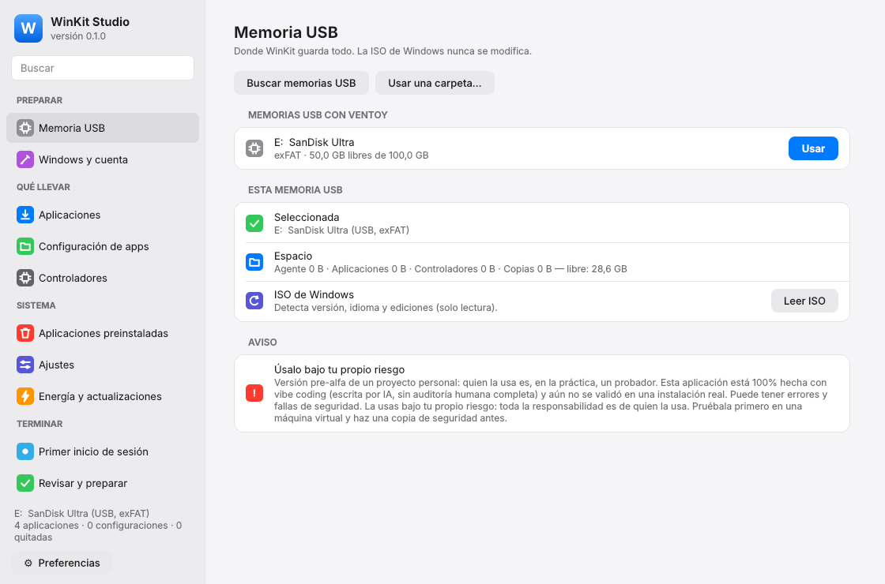
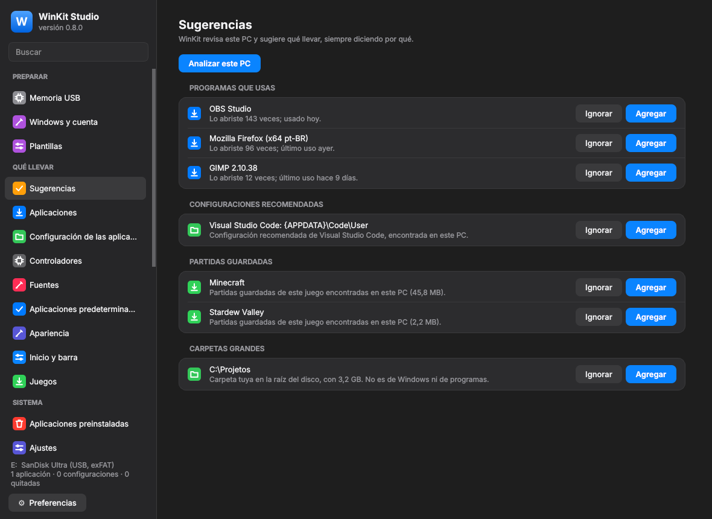

<div align="center">




# WinKit

[Português](README.md) · [English](README.en.md) · **Español**

**Instala Windows ya a tu gusto — controladores, aplicaciones, configuración y privacidad — desde una memoria USB con Ventoy (o creada con Rufus o la herramienta de Microsoft), sin modificar la ISO. O aplica la misma receta al Windows que ya tienes.**

[](https://github.com/luckasiasantos-source/WinKit/actions/workflows/ci.yml)


[](LICENSE)


</div>

> [!CAUTION]
> **Pre-alfa, 100% hecho con vibe coding, proyecto personal. Úsalo bajo tu propio riesgo.**
> WinKit se hizo para uso propio, como una prueba, y no como un producto lanzado. Quien lo use será, en la práctica, un probador.
> Todo el código de WinKit lo escribió inteligencia artificial, sin auditoría humana completa, y **aún no se validó en una instalación real de Windows**. Toca partes sensibles del sistema (instalación, registro, controladores, cuentas, archivos) y puede tener errores o fallas de seguridad que causen pérdida de datos o un Windows inutilizable.
> **Toda la responsabilidad es de quien lo descarga y lo usa.** El autor no se responsabiliza por ningún daño, pérdida o falla de seguridad. Pruébalo primero en una máquina virtual, haz una copia de seguridad antes y [reporta los errores que encuentres](https://github.com/luckasiasantos-source/WinKit/issues). Consulta la sección [Aviso](#aviso).

---

## Por qué existe

Reinstalar Windows es rápido; lo que lleva tiempo es dejarlo a tu gusto: buscar controladores, descargar e instalar aplicación por aplicación, volver a configurar cada una, quitar lo que vino de regalo, apagar la telemetría, ordenar la barra de tareas…

WinKit lo hace todo de una vez. Armas una **receta** en tu PC actual y la memoria USB con Ventoy instala Windows ya listo, con la misma ISO original que descargaste de Microsoft.

## Qué hace

| | |
|---|---|
| 🔌 **Ventoy, sin tocar la ISO** | Usa el complemento `auto_install` de Ventoy. Cambia la ISO por una versión nueva y todo sigue funcionando. Una memoria USB sirve para varias ISO. |
| 👤 **Cuenta local** | Sin cuenta Microsoft, sin pantallas de red y privacidad. Idioma, teclado, zona horaria y edición se toman de tu PC actual y se pueden cambiar en la receta. |
| 💽 **El disco nunca se cifra solo** | De forma predeterminada, Windows no activa el cifrado automático del dispositivo, ni siquiera después de iniciar sesión con una cuenta Microsoft. |
| 🧩 **Controladores de tu PC** | Exporta los controladores de terceros (red primero) y los instala con `pnputil` antes del primer inicio de sesión. |
| 📦 **Tus aplicaciones** | Lee las aplicaciones instaladas en tu PC; marcas las que quieres. Las instala sin conexión (instaladores descargados con `winget download`) o con winget en línea. Cierra las aplicaciones que abre el instalador y desactiva el inicio automático. |
| 🗂️ **Configuración de las aplicaciones** | Elige carpetas y archivos de configuración (Discord, VS Code, OBS, partidas guardadas…). Se copian a la memoria USB con una instantánea (incluso con la aplicación abierta) y se restauran en el lugar correcto **antes** de abrir la aplicación en el Windows nuevo. |
| 🧹 **Aplicaciones preinstaladas** | Quita lo que elijas (lista con niveles de riesgo) y evita que vuelvan con las actualizaciones. |
| 🎛️ **Ajustes** | Privacidad (telemetría mínima, identificador de publicidad, Bing en Inicio, Copilot, Recall…), apariencia (tema oscuro, barra a la izquierda, menú contextual clásico…), energía. Se aplican al perfil predeterminado: tu cuenta nace ya configurada. |
| 🔄 **Windows Update** | Opcional, al final, con la API oficial. |
| 🪟 **Primer inicio de sesión a tu manera** | Silencioso (solo un aviso al final), con cuenta regresiva o interactivo — y elementos marcados como "preguntar" para decidir en el momento. |
| 🧾 **Resumen y registros** | Resumen en HTML en el escritorio y registros guardados de vuelta en la memoria USB. |
| 🌎 **Tres idiomas** | Portugués, inglés y español en Studio, en la línea de comandos y en el primer inicio de sesión. Automático según el idioma de Windows o elegido en Preferencias. |

### Novedades de la versión 2

| | |
|---|---|
| 💡 **Sugerencias de qué llevar** | WinKit revisa este PC y sugiere los programas que más usas, las configuraciones recomendadas, las partidas guardadas y las carpetas grandes en C:, siempre diciendo por qué. No se agrega nada hasta que hagas clic en "Agregar", y el análisis se hace solo en este PC. |
| 🖥️ **Aplicar en este PC** | La misma receta en un Windows ya instalado, sin reinstalar: vista previa de lo que cambia, punto de restauración antes y solo los pasos seguros en un sistema en uso. |
| 💾 **Memoria USB común** | Además de Ventoy, funciona con la memoria USB creada por Rufus o por la Herramienta de creación de medios de Microsoft. |
| 📶 **Red y sistema** | Redes Wi-Fi conectadas antes del inicio de sesión, características de Windows (WSL, Sandbox, .NET 3.5…), controladores que faltan desde Windows Update, DNS seguro y bloqueo de anuncios en `hosts`, unidades de red, tareas de mantenimiento y variables de entorno. |
| 🎨 **Personalización** | Perfiles rápidos (Gamer, Privacidad máxima, Oficina, Programador), fuentes, aplicaciones predeterminadas, fondo de pantalla y colores, navegadores con extensiones y buscador, y el menú Inicio y la barra anclados. |
| 🗃️ **Cuentas, carpetas y juegos** | Cuentas adicionales (administrador o estándar), Documentos y Descargas en otro disco (encontrado por número de serie aunque cambie la letra) y juegos de Steam y Epic en otro disco que aparecen instalados, sin volver a descargarlos. |
| 📋 **Plantillas y recetas compartibles** | Empieza desde una plantilla o importa la receta de otra persona, siempre con vista previa. La exportación nunca lleva tu cuenta, contraseña, Wi-Fi ni rutas personales. |
| ⬆️ **Instaladores siempre nuevos** | «Buscar actualizaciones» reemplaza los instaladores viejos de la memoria USB sin rehacer la receta; la versión antigua solo se borra cuando la nueva ya está en su lugar. |
| 🔍 **Comparación con el PC antiguo** | Al final de la instalación, el resumen muestra las aplicaciones que faltaron, los dispositivos sin controlador y las características que no se activaron. |

<div align="center">

</div>

## Cómo funciona

```
 Tu PC actual                 Memoria USB con Ventoy                  Windows nuevo
┌──────────────┐  guarda    ┌────────────────────────────┐ arranque ┌───────────────────────────┐
│ WinKit Studio│ ─────────► │ ISO originales (intactas)  │ ───────► │ instalación automática     │
│  receta      │            │ ventoy/ventoy.json + XML   │          │ Fase 1 (antes del inicio): │
│  aplicaciones│            │ WinKit/                    │          │  controladores, bloatware, │
│  controlador.│            │   receta, instaladores,    │          │  ajustes, apps, copias     │
│  copias      │            │   controladores, Agente    │          │ Fase 2 (después):          │
└──────────────┘            └────────────────────────────┘          │  apps por usuario, winget, │
                                                                     │  Windows Update, resumen   │
                                                                     └───────────────────────────┘
```

1. **Studio** (o la línea de comandos) lee tu PC y guarda la receta y todo el contenido en la carpeta `WinKit\` de la memoria USB.
2. Ventoy inyecta un `autounattend.xml` en la instalación. Solo eliges el disco: WinKit **nunca** particiona ni formatea nada por su cuenta.
3. Durante la instalación, un pequeño script encuentra la memoria USB y prepara el **Agente**.
4. El Agente hace casi todo antes de la pantalla de inicio de sesión. Lo que necesita tu usuario o internet ocurre justo después, en segundo plano o con una ventana, como elijas.

## Primeros pasos

### Requisitos

- Windows 10 u 11 en el PC donde preparas la memoria USB (Studio pide permisos de administrador).
- Una memoria USB con [Ventoy](https://www.ventoy.net) instalado y una ISO original de Windows 11.

### Uso

1. Descarga `WinKit-…-windows-x64.zip` de la página de [**Releases**](https://github.com/luckasiasantos-source/WinKit/releases) y descomprímelo. No hay que compilar nada. Los ejecutables no están firmados: si SmartScreen avisa, haz clic en "Más información" → "Ejecutar de todas formas".
2. Abre `winkit-studio\winkit-studio.exe`.
3. Sigue la barra lateral de arriba hacia abajo (grupos **Preparar**, **Qué llevar**, **Sistema** y **Terminar**). El botón **Preferencias** cambia el idioma y el tema.
4. Arranca desde Ventoy, elige la ISO y la plantilla `winkit-…`. Con una memoria USB de Rufus o de Microsoft, solo arranca desde ella (ver [`docs/RUFUS.md`](docs/RUFUS.md), en portugués).
5. Para usar la receta en el Windows que ya tienes, abre **Aplicar en este PC** (grupo Terminar): WinKit muestra la vista previa y crea un punto de restauración antes.

### Línea de comandos

Todo lo que hace Studio también está en la CLI (ejecútala como administrador). Usa `--idioma es` para los mensajes en español:

```powershell
winkit --idioma es pendrive listar
winkit receita nova --pendrive E: --usuario Ana --nome-pc MI-PC
winkit coletar apps --pendrive E:
winkit apps marcar discord 7zip vscode --pendrive E:
winkit apps baixar --pendrive E:
winkit coletar backups --pendrive E: --adicionar-recomendados
winkit backup capturar --pendrive E:
winkit coletar drivers --pendrive E:
winkit sugestoes listar --pendrive E:
winkit receita modelo gamer --aplicar --pendrive E:
winkit dns definir cloudflare --pendrive E:
winkit plano --pendrive E:
winkit construir --pendrive E:
winkit validar --pendrive E:
winkit aplicar --pendrive E: --simular    # vista previa de «Aplicar en este PC»
```

## Estado del proyecto

**Pre-alfa.** Las versiones 1 y 2 están implementadas y probadas automáticamente (más de 700 pruebas en Linux y Windows, con ejecutables generados y probados en la CI). El plan de la v2 está en [`docs/PLANO_V2.md`](docs/PLANO_V2.md) (en portugués); lo que aún es provisional está en [`docs/DIVIDAS_TECNICAS.md`](docs/DIVIDAS_TECNICAS.md). La validación en máquina virtual y en un PC real sigue los guiones de [`docs/validacao/`](docs/validacao/).

> ⚠️ Úsalo primero en una máquina virtual. Los valores del registro y los nombres de paquetes de Windows cambian entre versiones.

## Compilar desde el código

```powershell
git clone https://github.com/luckasiasantos-source/WinKit
cd WinKit
uv sync                     # Python 3.12 y dependencias
uv run pytest               # pruebas
powershell -ExecutionPolicy Bypass -File packaging\build.ps1   # genera dist\WinKit-<versión>
```

## Arquitectura

Python 3.12 + PySide6, en capas con reglas verificadas automáticamente:

| Capa | Contenido |
|---|---|
| `core/` | Lógica pura (receta, planificador de fases, plantillas de rutas, XML, Ventoy, manifiesto), probada sin Windows |
| `platform/` | Todo lo que toca Windows (registro, PowerShell, robocopy, VSS, pnputil, winget, Appx), detrás de interfaces con versiones simuladas para las pruebas |
| `collector/`, `builder/`, `agent/` | Casos de uso: recopilar del PC actual, preparar la memoria USB, configurar el Windows nuevo |
| `ui/`, `studio/`, `agent/ui/` | Interfaz al estilo macOS (tema claro/oscuro) |
| `i18n/`, `data/` | Textos en tres idiomas; catálogos versionados (aplicaciones conocidas, ajustes con fuente y deshacer, bloatware, ediciones, características de Windows, DNS y listas de bloqueo, perfiles rápidos, partidas guardadas, plantillas de receta) |

La documentación del proyecto (`docs/`) está en portugués; [`docs/ESTRUTURA.md`](docs/ESTRUTURA.md) tiene el árbol del proyecto con lo que hace cada archivo de código.

## Contribuir

Las contribuciones son bienvenidas, sobre todo:

- entradas en el catálogo de aplicaciones (`src/winkit/data/app_catalog.yaml`): carpetas de configuración y parámetros silenciosos;
- ajustes y bloatware validados en versiones nuevas de Windows;
- correcciones de los textos en inglés y español (`src/winkit/i18n/messages/`, `src/winkit/data/i18n_*.yaml`);
- informes de prueba en VM o PC real.

Antes de abrir un PR, lee [`CONTRIBUTING.md`](CONTRIBUTING.md) y ejecuta `scripts/check.sh`.

## Aviso

**Versión pre-alfa de un proyecto personal.** WinKit se hizo para uso propio, como una prueba, y no como un producto lanzado. Está abierto para quien quiera usarlo, pero quien lo usa es, en la práctica, un probador (beta tester), con todo lo que eso implica: pueden faltar funciones, puede cambiar sin aviso y no hay soporte garantizado.

**WinKit está 100% hecho con vibe coding.** Todo el código, las pruebas, la documentación y las traducciones al inglés y al español los escribió inteligencia artificial, sin auditoría humana completa. Las pruebas automáticas pasan, pero no reemplazan una instalación real, que aún no se hizo. «Aplicar en este PC» cambia el Windows que usas todos los días: usa la vista previa y revisa el punto de restauración antes.

Al descargar, compilar o usar WinKit, aceptas que:

- **el uso es totalmente bajo tu propio riesgo**;
- **toda la responsabilidad es tuya**, de quien lo descargó y lo usó: por pérdida de datos, por un Windows que no arranca, por fallas de seguridad, por cualquier daño a tu equipo o a terceros;
- el autor y los colaboradores **no se responsabilizan por nada**, según las secciones 7 (exención de garantías) y 8 (limitación de responsabilidad) de la [licencia](LICENSE) y el archivo [`NOTICE`](NOTICE);
- te corresponde probarlo (de preferencia en una máquina virtual), comprobar que funciona y hacer una copia de seguridad antes.

¿Encontraste un error o una falla de seguridad? [Abre un issue](https://github.com/luckasiasantos-source/WinKit/issues).

WinKit automatiza la instalación de una copia de Windows que tienes derecho a usar. No activa Windows ni evade licencias: las claves que usa solo eligen la edición en el instalador.

## Licencia

[Apache License 2.0](LICENSE). Lee también el [`NOTICE`](NOTICE).
