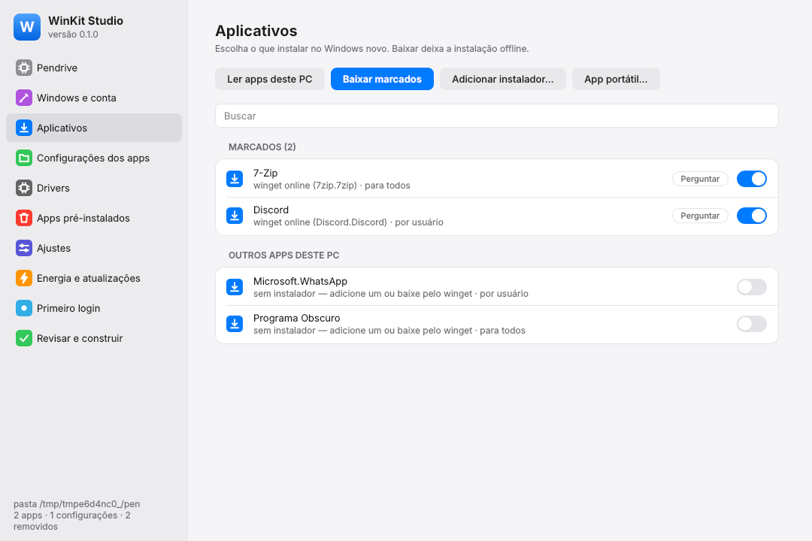
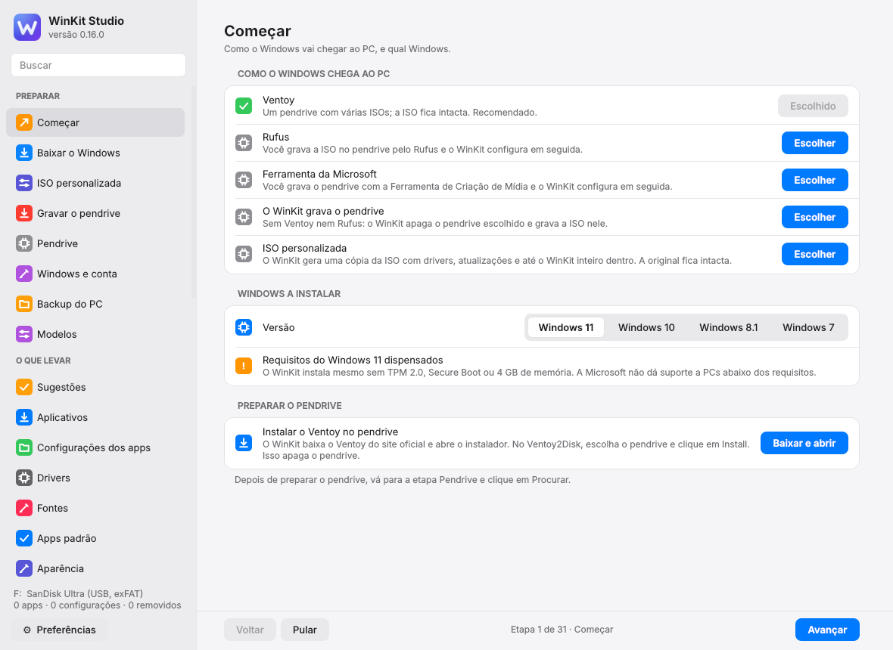
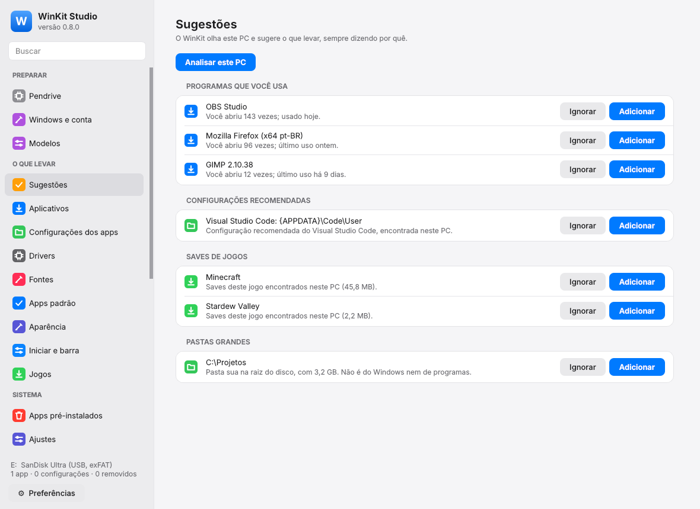
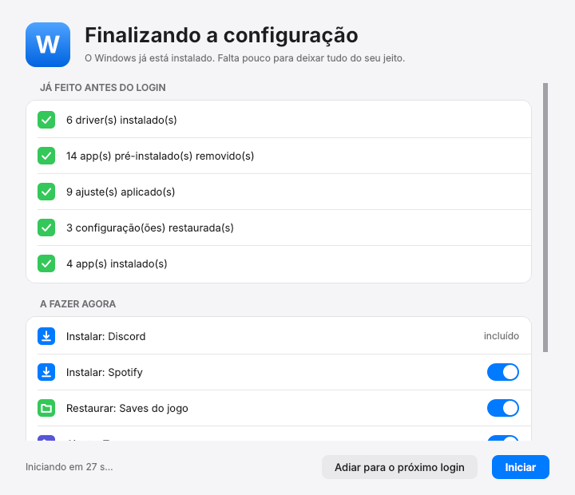
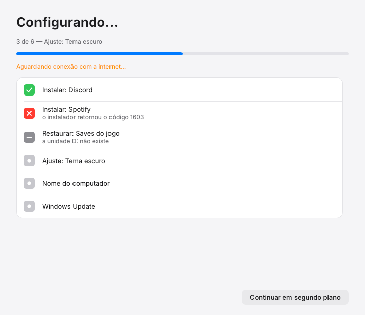
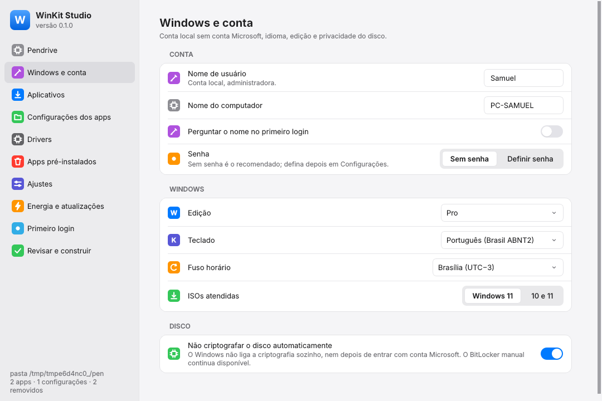
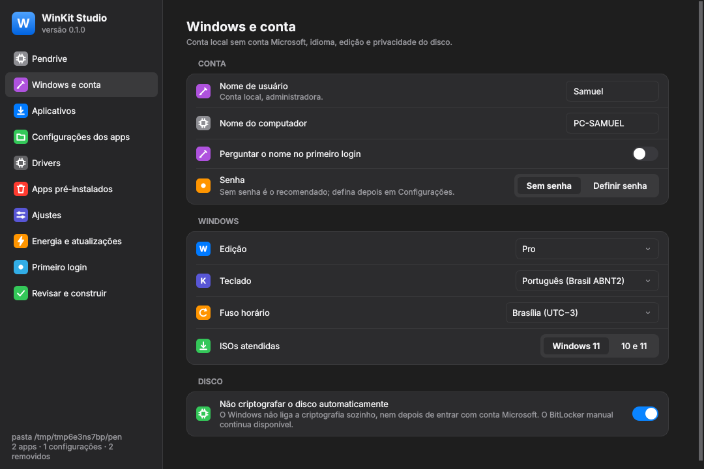
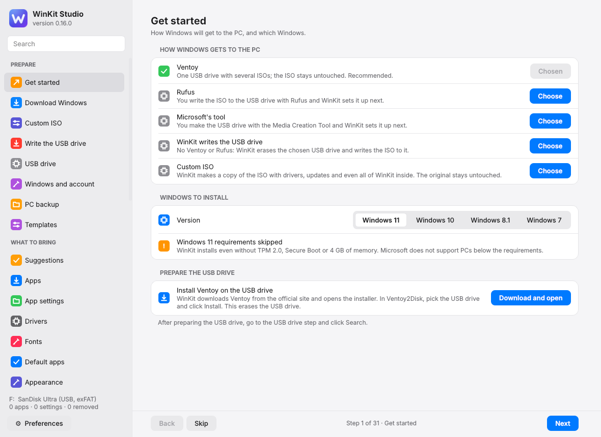
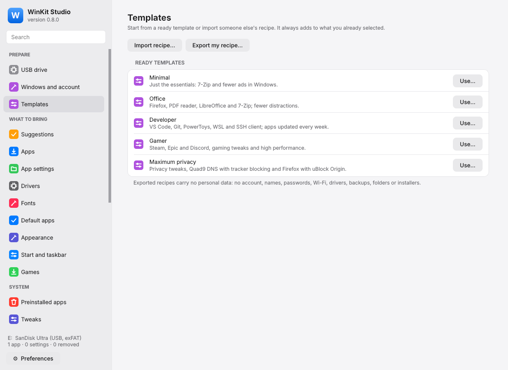

<div align="center">




# WinKit

**Português** · [English (below)](#english) · [Español](README.es.md)

**Instale o Windows já do seu jeito — drivers, apps, configurações e privacidade — a partir de um pendrive Ventoy (ou do Rufus e da Microsoft), sem modificar a ISO original. Ou aplique a mesma receita no Windows que você já tem.**

[](https://github.com/luckasiasantos-source/WinKit/actions/workflows/ci.yml)


[](LICENSE)


</div>

> [!CAUTION]
> **Pré-alpha, 100% vibe-codado, projeto pessoal. Use por sua conta e risco.**
> O WinKit foi feito para uso próprio, como um teste, e não como um produto lançado. Quem usar será, na prática, um testador.
> Todo o código do WinKit foi escrito por inteligência artificial, sem auditoria humana completa, e ainda **não foi validado numa instalação real do Windows**. Ele mexe em partes sensíveis do sistema (instalação, registro, drivers, contas, arquivos) e pode ter erros ou falhas de segurança que causem perda de dados ou um Windows inutilizável.
> **Toda a responsabilidade é de quem baixa e usa.** O autor não se responsabiliza por nenhum dano, perda ou falha de segurança. Teste primeiro numa máquina virtual, faça backup antes e [relate os erros que encontrar](https://github.com/luckasiasantos-source/WinKit/issues). Veja a seção [Aviso](#aviso).

> 🇺🇸 **English speaker?** The full English version of this page is [right below the Portuguese one](#english) (or open [README.en.md](README.en.md)).

---

## Por que existe

Reinstalar o Windows é rápido; deixar ele do seu jeito é que demora: caçar drivers, baixar e instalar app por app, reconfigurar cada um, remover o que veio de brinde, desligar telemetria, arrumar a barra de tarefas…

O WinKit faz isso de uma vez. Você monta uma **receita** no seu PC atual, e o pendrive Ventoy instala o Windows já pronto, com a mesma ISO original que você baixou da Microsoft.

## O que ele faz

| | |
|---|---|
| 🔌 **Ventoy, sem tocar na ISO** | Usa o plugin `auto_install` do Ventoy. Troque a ISO por uma versão nova e tudo continua funcionando. Um pendrive serve a várias ISOs. |
| 👤 **Conta local** | Sem conta Microsoft, sem telas de rede e privacidade. Idioma, teclado, fuso e edição vêm do seu PC atual e podem ser mudados na receita. |
| 💽 **Disco nunca criptografado sozinho** | Por padrão o Windows não liga a criptografia automática do dispositivo — nem depois de entrar com conta Microsoft. |
| 🧩 **Drivers do seu PC** | Exporta os drivers de terceiros (rede primeiro) e instala com `pnputil` antes do primeiro login. |
| 📦 **Seus aplicativos** | Lê os apps instalados no seu PC; você marca os que quer. Instala offline (instaladores baixados com `winget download`) ou pelo winget online. Fecha os apps abertos pelo instalador e desliga a inicialização automática. |
| 🗂️ **Configurações dos apps** | Escolha pastas e arquivos de configuração (Discord, VS Code, OBS, saves de jogos…). São copiados para o pendrive com cópia de sombra (mesmo com o app aberto) e restaurados no lugar certo **antes** de você abrir o app no Windows novo. |
| 🧹 **Apps pré-instalados** | Remove o que você escolher (lista em níveis de risco) e impede que voltem com as atualizações. |
| 🎛️ **Ajustes** | Privacidade (telemetria mínima, ID de anúncios, Bing no Iniciar, Copilot, Recall…), aparência (tema escuro, barra à esquerda, menu de contexto clássico…), energia. Aplicados ao perfil padrão: a conta já nasce configurada. |
| 🔄 **Windows Update** | Opcional, no final, pela API oficial. |
| 🪟 **Primeiro login do seu jeito** | Silencioso (só um aviso no fim), com contagem regressiva ou interativo — e itens marcados como "perguntar" para decidir na hora. |
| 🧾 **Resumo e logs** | Resumo em HTML na área de trabalho e logs gravados de volta no pendrive. |
| 🌎 **Três idiomas** | Português, inglês e espanhol, no Studio, na linha de comando e no primeiro login. Automático pelo idioma do Windows ou escolhido em Preferências. |

### Novidades da versão 2

| | |
|---|---|
| 💡 **Sugestões do que levar** | O WinKit olha este PC e sugere os programas que você mais usa, as configurações recomendadas, os saves de jogos e as pastas grandes no C:, sempre dizendo por quê. Nada entra sem você clicar em "Adicionar", e a análise é feita só neste PC. |
| 🖥️ **Aplicar neste PC** | A mesma receita num Windows já instalado, sem reinstalar: prévia do que muda, ponto de restauração antes e só as etapas seguras ao vivo. |
| 💾 **Pendrive comum** | Além do Ventoy, funciona com o pendrive gravado pelo Rufus ou pela Ferramenta de Criação de Mídia da Microsoft. |
| 📶 **Rede e sistema** | Redes Wi-Fi conectadas antes do login, recursos do Windows (WSL, Sandbox, .NET 3.5…), drivers que faltam pelo Windows Update, DNS seguro e bloqueio de anúncios no `hosts`, unidades de rede, tarefas de manutenção e variáveis de ambiente. |
| 🎨 **Personalização** | Perfis rápidos (Gamer, Privacidade máxima, Escritório, Programador), fontes, apps padrão, papel de parede e cores, navegadores com extensões e buscador, e o menu Iniciar e a barra fixados. |
| 🗃️ **Contas, pastas e jogos** | Contas extras (administrador ou padrão), Documentos e Downloads em outro disco (achado pelo número de série, mesmo se a letra mudar) e jogos da Steam e da Epic em outro disco aparecendo instalados, sem baixar de novo. |
| 📋 **Modelos e receitas compartilháveis** | Comece de um modelo pronto ou importe a receita de outra pessoa, sempre com prévia. A exportação nunca leva conta, senha, Wi-Fi nem caminhos pessoais. |
| ⬆️ **Instaladores sempre novos** | "Procurar atualizações" troca os instaladores velhos do pendrive sem refazer a receita; a versão antiga só sai depois que a nova está no lugar. |
| 🕰️ **Windows 7 e 8.1** | Em modo limitado, 32 e 64 bits: instalação automática, drivers, programas com instalador próprio, configurações, Wi-Fi e energia, com aviso de que não recebem mais correções de segurança. O 7 "SP2" (Convenience Rollup) pode ir dentro da ISO personalizada. |
| 🔥 **O WinKit grava o pendrive** | Sem Ventoy nem Rufus: escolha o pendrive e o tipo de PC (UEFI, BIOS ou os dois) e confirme digitando a letra. Só pendrives USB aparecem; discos internos e HDs externos nunca. |
| 💿 **ISO personalizada** | Uma **cópia** da ISO com as edições que você quer, drivers deste PC (o instalador passa a ver o SSD), atualizações e sem os apps de fábrica marcados. Pode ser **autossuficiente**: o WinKit inteiro vai dentro e a ISO instala tudo sozinha. A original nunca é modificada. |
| 🗄️ **Backup para outro disco** | Copia seus arquivos para um HD, SSD ou pendrive antes de formatar, mostrando o tipo do disco e o tempo medido; cada arquivo é conferido e nada é apagado. Depois, traz de volta somando ao que existe, à mão ou na própria instalação. A etapa **Antes de formatar** confere o backup, o BitLocker (e exporta a chave) e a ativação. |
| 🔍 **Comparação com o PC antigo** | No fim da instalação, o resumo mostra os apps que faltaram, os dispositivos sem driver e os recursos que não foram ligados. |

<div align="center">


</div>

<div align="center">


</div>

## Como funciona

```
 Seu PC atual                 Pendrive Ventoy                         Windows novo
┌──────────────┐   grava    ┌────────────────────────────┐   boot   ┌───────────────────────────┐
│ WinKit Studio│ ─────────► │ ISOs originais (intactas)  │ ───────► │ instalação automatizada    │
│  receita     │            │ ventoy/ventoy.json + XML   │          │ Fase 1 (antes do login):   │
│  apps        │            │ WinKit/                    │          │  drivers, bloatware,       │
│  drivers     │            │   receita, instaladores,   │          │  ajustes, apps, backups    │
│  backups     │            │   drivers, backups, Agente │          │ Fase 2 (depois do login):  │
└──────────────┘            └────────────────────────────┘          │  apps por usuário, winget, │
                                                                     │  Windows Update, resumo    │
                                                                     └───────────────────────────┘
```

1. O **Studio** (ou a linha de comando) lê o seu PC e grava a receita e todo o conteúdo na pasta `WinKit\` do pendrive.
2. O Ventoy injeta um `autounattend.xml` na instalação. Você só escolhe o disco: o WinKit **nunca** particiona nem formata nada sozinho.
3. Durante a instalação, um pequeno script encontra o pendrive e prepara o **Agente**.
4. O Agente faz quase tudo antes da tela de login. O que precisa do seu usuário ou da internet acontece logo depois, em segundo plano ou com janela, como você escolher.

## Começando

### Requisitos

- Windows 10 ou 11 no PC onde você monta o pendrive (o Studio pede administrador).
- Um pendrive com o [Ventoy](https://www.ventoy.net) instalado e uma ISO original do Windows 11.

### Usar

1. Baixe o `WinKit-…-windows-x64.zip` na página de [**Releases**](https://github.com/luckasiasantos-source/WinKit/releases) e extraia. Não precisa compilar nada. Os executáveis não são assinados: se o SmartScreen avisar, clique em "Mais informações" → "Executar assim mesmo".
2. Abra `winkit-studio\winkit-studio.exe`.
3. Na primeira etapa, **Começar**, escolha o Windows (11, 10, 8.1 ou 7) e como ele chega ao PC: **Ventoy** ou **Rufus** (o WinKit baixa do site oficial e abre para você gravar o pendrive) ou a ferramenta da Microsoft. Sem ISO? A etapa **Baixar o Windows** baixa a oficial da Microsoft, com pausa e retomada. Depois siga com **Avançar** (ou **Pular**) na barra de baixo, ou clique direto em qualquer seção da barra lateral. O botão **Preferências** troca idioma e tema.
4. Dê boot pelo Ventoy, escolha a ISO e o modelo `winkit-…`. Com um pendrive do Rufus ou da Microsoft, só dê boot por ele (veja [`docs/RUFUS.md`](docs/RUFUS.md)).
5. Para usar a receita no Windows que você já tem, abra **Aplicar neste PC** (grupo Concluir): o WinKit mostra a prévia e cria um ponto de restauração antes.

<div align="center">


</div>

### Linha de comando

Tudo que o Studio faz também existe na CLI (rode como administrador). Use `--idioma en-US` ou `--idioma es` para outro idioma; os comandos também aceitam nomes em inglês (`winkit build`, `winkit recipe new`…):

```powershell
winkit pendrive listar
winkit receita nova --pendrive E: --usuario Samuel --nome-pc MEU-PC
winkit coletar apps --pendrive E:
winkit apps marcar discord 7zip vscode --pendrive E:
winkit apps baixar --pendrive E:
winkit coletar backups --pendrive E: --adicionar-recomendados
winkit backup capturar --pendrive E:
winkit coletar drivers --pendrive E:
winkit sugestoes listar --pendrive E:
winkit receita modelo gamer --aplicar --pendrive E:
winkit dns definir cloudflare --pendrive E:
winkit plano --pendrive E:
winkit construir --pendrive E:
winkit validar --pendrive E:
winkit aplicar --pendrive E: --simular    # prévia do "Aplicar neste PC"
```

## Estado do projeto

**Pré-alpha.** As versões 1, 2 e 3 estão implementadas e testadas automaticamente (mais de 770 testes em Linux e Windows, com executáveis gerados e testados no CI). O plano da v2 está em [`docs/PLANO_V2.md`](docs/PLANO_V2.md); o que ainda é provisório está em [`docs/DIVIDAS_TECNICAS.md`](docs/DIVIDAS_TECNICAS.md). A validação em máquina virtual e em PC real segue os roteiros de [`docs/validacao/`](docs/validacao/). Veja [`docs/STATUS.md`](docs/STATUS.md).

> ⚠️ Use primeiro numa máquina virtual ([`docs/validacao/AMBIENTE_VM.md`](docs/validacao/AMBIENTE_VM.md)). Valores de registro e nomes de pacotes do Windows mudam entre versões.

## Compilar a partir do código

```powershell
git clone https://github.com/luckasiasantos-source/WinKit
cd WinKit
uv sync                     # Python 3.12 e dependências
uv run pytest               # testes
powershell -ExecutionPolicy Bypass -File packaging\build.ps1   # gera dist\WinKit-<versão>
```

## Arquitetura

O código é Python 3.12 + PySide6, em camadas com regras verificadas automaticamente:

| Camada | O que tem |
|---|---|
| `core/` | Lógica pura (receita, planejador de fases, moldes de caminho, XML, Ventoy, manifesto), testável sem Windows |
| `platform/` | Tudo que toca o Windows (registro, PowerShell, robocopy, VSS, pnputil, winget, Appx), atrás de interfaces com versões falsas para testes |
| `collector/`, `builder/`, `agent/` | Casos de uso: coletar do PC atual, montar o pendrive, configurar o Windows novo |
| `ui/`, `studio/`, `agent/ui/` | Interface no estilo macOS (tema claro/escuro) |
| `data/` | Catálogos versionados: apps conhecidos, ajustes (com fonte e "desfazer"), bloatware, edições, recursos do Windows, DNS e listas de bloqueio, perfis rápidos, saves de jogos e modelos de receita |

Documentação completa:

- [`docs/PLANO.md`](docs/PLANO.md) e [`docs/PLANO_V2.md`](docs/PLANO_V2.md): o produto e o desenho
- [`docs/ARQUITETURA.md`](docs/ARQUITETURA.md): camadas, regras do código e registro de decisões
- [`docs/ESTRUTURA.md`](docs/ESTRUTURA.md): a árvore do projeto, com o que cada arquivo faz
- [`docs/STATUS.md`](docs/STATUS.md), [`docs/DIVIDAS_TECNICAS.md`](docs/DIVIDAS_TECNICAS.md), [`docs/INCIDENTES.md`](docs/INCIDENTES.md), [`docs/CHANGELOG.md`](docs/CHANGELOG.md)

## Contribuir

Contribuições são bem-vindas, principalmente:

- entradas no catálogo de apps (`src/winkit/data/app_catalog.yaml`): pastas de configuração e parâmetros silenciosos;
- ajustes e bloatware validados em versões novas do Windows;
- relatos de teste em VM ou PC real, seguindo os roteiros de `docs/validacao/`.

Antes de abrir um PR, leia o [`CONTRIBUTING.md`](CONTRIBUTING.md) e rode `scripts/check.sh`.

## Aviso

**Versão pré-alpha de um projeto pessoal.** O WinKit foi feito para uso próprio, como um teste, e não como um produto lançado. Ele está aberto para quem quiser usar, mas quem usa é, na prática, um testador (beta tester), com todos os poréns disso: pode faltar recurso, mudar sem aviso e não há suporte garantido.

**O WinKit é 100% vibe-codado.** Todo o código, os testes, a documentação e as traduções para inglês e espanhol foram escritos por inteligência artificial, sem auditoria humana completa. Os testes automáticos passam, mas eles não substituem uma instalação real, que ainda não foi feita. O modo "Aplicar neste PC" mexe no Windows que você usa todo dia: use a prévia e confira o ponto de restauração antes.

Ao baixar, compilar ou usar o WinKit, você concorda que:

- **o uso é inteiramente por sua conta e risco**;
- **toda a responsabilidade é sua**, de quem baixou e usou: por perda de dados, por um Windows que não inicia, por falhas de segurança, por qualquer dano ao seu computador ou a terceiros;
- o autor e os contribuidores **não se responsabilizam por nada**, conforme as seções 7 (sem garantias) e 8 (limitação de responsabilidade) da [licença](LICENSE) e o arquivo [`NOTICE`](NOTICE);
- cabe a você testar (de preferência numa máquina virtual), conferir se funciona e fazer backup antes.

Encontrou um erro ou uma falha de segurança? [Abra uma issue](https://github.com/luckasiasantos-source/WinKit/issues).

O WinKit automatiza a instalação de um Windows que você tem direito de usar. Ele não ativa o Windows nem contorna licenciamento: as chaves usadas só selecionam a edição no instalador.

## Licença

[Apache License 2.0](LICENSE). Leia também o [`NOTICE`](NOTICE).

---

<!-- english:start (gerado por scripts/sync_readme.py a partir de README.en.md) -->

<a id="english"></a>

# WinKit — English version

> [!CAUTION]
> **Pre-alpha, 100% vibe-coded, personal project. Use at your own risk.**
> WinKit was made for the author's own use, as an experiment, not as a released product. Anyone who uses it is, in practice, a tester.
> All of WinKit's code was written by artificial intelligence, without a full human review, and it **has not yet been validated on a real Windows install**. It touches sensitive parts of the system (setup, registry, drivers, accounts, files) and may have bugs or security flaws that cause data loss or an unusable Windows.
> **All responsibility lies with whoever downloads and uses it.** The author accepts no liability for any damage, loss or security flaw. Test it in a virtual machine first, back up beforehand and [report the bugs you find](https://github.com/luckasiasantos-source/WinKit/issues). See the [Warning](#warning) section.

---

## Why it exists

Reinstalling Windows is quick; making it your own is what takes time: hunting for drivers, downloading and installing app after app, setting each one up again, removing the extras, turning off telemetry, fixing the taskbar…

WinKit does it all at once. You build a **recipe** on your current PC, and the Ventoy USB drive installs Windows already set up, from the same original ISO you downloaded from Microsoft.

## What it does

| | |
|---|---|
| 🔌 **Ventoy, ISO untouched** | Uses Ventoy's `auto_install` plugin. Swap the ISO for a newer one and everything keeps working. One USB drive serves several ISOs. |
| 👤 **Local account** | No Microsoft account, no network and privacy screens. Language, keyboard, time zone and edition come from your current PC and can be changed in the recipe. |
| 💽 **Disk never encrypted by itself** | By default Windows does not turn on automatic device encryption — not even after you sign in with a Microsoft account. |
| 🧩 **Your PC's drivers** | Exports third-party drivers (network first) and installs them with `pnputil` before the first sign-in. |
| 📦 **Your apps** | Reads the apps installed on your PC; you pick the ones you want. Installs offline (installers downloaded with `winget download`) or through winget online. Closes apps opened by the installer and turns off auto-start. |
| 🗂️ **App settings** | Choose settings folders and files (Discord, VS Code, OBS, game saves…). They are copied to the USB drive with a shadow copy (even with the app open) and restored to the right place **before** you open the app on the new Windows. |
| 🧹 **Preinstalled apps** | Removes what you choose (list with risk levels) and keeps them from coming back with updates. |
| 🎛️ **Tweaks** | Privacy (minimum telemetry, advertising ID, Bing in Start, Copilot, Recall…), appearance (dark theme, left taskbar, classic context menu…), power. Applied to the default profile: your account is born already set up. |
| 🔄 **Windows Update** | Optional, at the end, through the official API. |
| 🪟 **First sign-in your way** | Silent (just a notice at the end), with a countdown or interactive — and items marked "ask" to decide at that moment. |
| 🧾 **Summary and logs** | HTML summary on the desktop and logs written back to the USB drive. |
| 🌎 **Three languages** | Portuguese, English and Spanish in Studio, on the command line and at first sign-in. Automatic from the Windows language or chosen in Preferences. |

### New in version 2

| | |
|---|---|
| 💡 **Suggestions of what to take** | WinKit looks at this PC and suggests the programs you use most, recommended settings, game saves and large folders on C:, always saying why. Nothing is added until you click "Add", and the analysis runs only on this PC. |
| 🖥️ **Apply to this PC** | The same recipe on an already installed Windows, without reinstalling: a preview of what changes, a restore point first and only the steps that are safe on a running system. |
| 💾 **Regular USB drive** | Besides Ventoy, it works with a USB drive made by Rufus or by Microsoft's Media Creation Tool. |
| 📶 **Network and system** | Wi-Fi networks connected before sign-in, Windows features (WSL, Sandbox, .NET 3.5…), missing drivers from Windows Update, secure DNS and ad blocking in `hosts`, network drives, maintenance tasks and environment variables. |
| 🎨 **Personalization** | Quick profiles (Gamer, Maximum privacy, Office, Developer), fonts, default apps, wallpaper and colors, browsers with extensions and search engine, and the Start menu and taskbar pins. |
| 🗃️ **Accounts, folders and games** | Extra accounts (administrator or standard), Documents and Downloads on another disk (found by serial number even if the letter changes), and Steam and Epic games on another disk showing up installed, without downloading again. |
| 📋 **Templates and shareable recipes** | Start from a ready template or import someone else's recipe, always with a preview. Exports never include your account, password, Wi-Fi or personal paths. |
| ⬆️ **Always-fresh installers** | "Check for updates" replaces old installers on the USB drive without redoing the recipe; the old version is only removed after the new one is in place. |
| 🕰️ **Windows 7 and 8.1** | In limited mode, 32 and 64-bit: unattended setup, drivers, programs with their own installer, settings, Wi-Fi and power, with a warning that they no longer get security fixes. Windows 7 "SP2" (Convenience Rollup) can go inside the custom ISO. |
| 🔥 **WinKit writes the USB drive** | No Ventoy or Rufus needed: pick the USB drive and the PC type (UEFI, BIOS or both) and confirm by typing its letter. Only USB drives are listed; internal disks and external HDDs never are. |
| 💿 **Custom ISO** | A **copy** of the ISO with the editions you want, this PC's drivers (so the installer sees the SSD), updates and without the checked preinstalled apps. It can be **self-contained**: all of WinKit goes inside and the ISO installs everything by itself. The original is never modified. |
| 🗄️ **Backup to another disk** | Copies your files to an HDD, SSD or USB drive before formatting, showing the disk type and the measured time; every file is checked and nothing is deleted. Later it brings them back by adding to what exists, by hand or during setup. The **Before formatting** step checks the backup, BitLocker (and exports the key) and activation. |
| 🔍 **Comparison with the old PC** | At the end of the install, the summary shows missing apps, devices without a driver and features that were not turned on. |

<div align="center">


</div>

## How it works

```
 Your current PC              Ventoy USB drive                        New Windows
┌──────────────┐  writes   ┌────────────────────────────┐   boot   ┌───────────────────────────┐
│ WinKit Studio│ ────────► │ Original ISOs (untouched)  │ ───────► │ unattended setup           │
│  recipe      │           │ ventoy/ventoy.json + XML   │          │ Phase 1 (before sign-in):  │
│  apps        │           │ WinKit/                    │          │  drivers, bloatware,       │
│  drivers     │           │   recipe, installers,      │          │  tweaks, apps, backups     │
│  backups     │           │   drivers, backups, Agent  │          │ Phase 2 (after sign-in):   │
└──────────────┘           └────────────────────────────┘          │  per-user apps, winget,    │
                                                                    │  Windows Update, summary   │
                                                                    └───────────────────────────┘
```

1. **Studio** (or the command line) reads your PC and writes the recipe and all the content to the `WinKit\` folder of the USB drive.
2. Ventoy injects an `autounattend.xml` into the setup. You only choose the disk: WinKit **never** partitions or formats anything by itself.
3. During setup, a small script finds the USB drive and prepares the **Agent**.
4. The Agent does almost everything before the sign-in screen. What needs your user or the internet happens right after, in the background or with a window, as you choose.

## Getting started

### Requirements

- Windows 10 or 11 on the PC where you prepare the USB drive (Studio asks for administrator rights).
- A USB drive with [Ventoy](https://www.ventoy.net) installed and an original Windows 11 ISO.

### Use

1. Download `WinKit-…-windows-x64.zip` from the [**Releases**](https://github.com/luckasiasantos-source/WinKit/releases) page and extract it. Nothing to compile. The executables are not signed: if SmartScreen warns you, click "More info" → "Run anyway".
2. Open `winkit-studio\winkit-studio.exe`.
3. In the first step, **Get started**, choose Windows (11, 10, 8.1 or 7) and how it gets to the PC: **Ventoy** or **Rufus** (WinKit downloads it from the official site and opens it for you to write the USB drive) or Microsoft's tool. No ISO? The **Download Windows** step gets the official one from Microsoft, with pause and resume. Then go on with **Next** (or **Skip**) in the bottom bar, or click any section in the sidebar. The **Preferences** button changes language and theme.
4. Boot from Ventoy, choose the ISO and the `winkit-…` template. With a Rufus or Microsoft USB drive, just boot from it (see [`docs/RUFUS.md`](docs/RUFUS.md), in Portuguese).
5. To use the recipe on the Windows you already have, open **Apply to this PC** (Finish group): WinKit shows a preview and creates a restore point first.

### Command line

Everything Studio does is also available on the CLI (run as administrator). Command names are in Portuguese and also accept English aliases; use `--idioma en-US` for English messages:

```powershell
winkit --idioma en-US drive list
winkit recipe new --pendrive E: --usuario Sam --nome-pc MY-PC
winkit collect apps --pendrive E:
winkit apps select discord 7zip vscode --pendrive E:
winkit apps download --pendrive E:
winkit collect backups --pendrive E: --adicionar-recomendados
winkit backup capture --pendrive E:
winkit collect drivers --pendrive E:
winkit suggestions list --pendrive E:
winkit recipe template gamer --aplicar --pendrive E:
winkit dns set cloudflare --pendrive E:
winkit plan --pendrive E:
winkit build --pendrive E:
winkit validate --pendrive E:
winkit apply --pendrive E: --simular    # preview of "Apply to this PC"
```

## Project status

**Pre-alpha.** Versions 1, 2 and 3 are implemented and automatically tested (over 770 tests on Linux and Windows, with executables built and smoke-tested in CI). The v2 plan is in [`docs/PLANO_V2.md`](docs/PLANO_V2.md) (in Portuguese); what is still provisional is in [`docs/DIVIDAS_TECNICAS.md`](docs/DIVIDAS_TECNICAS.md). Validation in a virtual machine and on a real PC follows the scripts in [`docs/validacao/`](docs/validacao/).

> ⚠️ Use it in a virtual machine first. Windows registry values and package names change between versions.

## Building from source

```powershell
git clone https://github.com/luckasiasantos-source/WinKit
cd WinKit
uv sync                     # Python 3.12 and dependencies
uv run pytest               # tests
powershell -ExecutionPolicy Bypass -File packaging\build.ps1   # creates dist\WinKit-<version>
```

## Architecture

Python 3.12 + PySide6, in layers whose rules are checked automatically:

| Layer | Contents |
|---|---|
| `core/` | Pure logic (recipe, phase planner, path templates, XML, Ventoy, manifest), testable without Windows |
| `platform/` | Everything that touches Windows (registry, PowerShell, robocopy, VSS, pnputil, winget, Appx), behind interfaces with fakes for tests |
| `collector/`, `builder/`, `agent/` | Use cases: collect from the current PC, build the USB drive, set up the new Windows |
| `ui/`, `studio/`, `agent/ui/` | macOS-style interface (light/dark theme) |
| `i18n/`, `data/` | Texts in three languages; versioned catalogs (known apps, tweaks with source and undo, bloatware, editions, Windows features, DNS and blocklists, quick profiles, game saves, recipe templates) |

The project documentation (`docs/`) is written in Portuguese; [`docs/ESTRUTURA.md`](docs/ESTRUTURA.md) has the project tree with what each code file does.

## Contributing

Contributions are welcome, especially:

- app catalog entries (`src/winkit/data/app_catalog.yaml`): settings folders and silent parameters;
- tweaks and bloatware validated on new Windows versions;
- corrections to the English and Spanish texts (`src/winkit/i18n/messages/`, `src/winkit/data/i18n_*.yaml`);
- test reports from a VM or real PC.

Before opening a PR, read [`CONTRIBUTING.md`](CONTRIBUTING.md) and run `scripts/check.sh`.

## Warning

**Pre-alpha version of a personal project.** WinKit was made for the author's own use, as an experiment, not as a released product. It is open to anyone who wants to use it, but whoever uses it is, in practice, a tester (beta tester), with all that this implies: features may be missing, things may change without notice and there is no guaranteed support.

**WinKit is 100% vibe-coded.** All the code, tests, documentation and the English and Spanish translations were written by artificial intelligence, without a full human review. The automated tests pass, but they do not replace a real install, which has not been done yet. "Apply to this PC" changes the Windows you use every day: use the preview and check the restore point first.

By downloading, building or using WinKit, you agree that:

- **you use it entirely at your own risk**;
- **all responsibility is yours**, whoever downloaded and used it: for data loss, for a Windows that does not boot, for security flaws, for any damage to your computer or to third parties;
- the author and contributors **are not liable for anything**, under sections 7 (disclaimer of warranty) and 8 (limitation of liability) of the [license](LICENSE) and the [`NOTICE`](NOTICE) file;
- it is up to you to test it (preferably in a virtual machine), check that it works and back up beforehand.

Found a bug or a security flaw? [Open an issue](https://github.com/luckasiasantos-source/WinKit/issues).

WinKit automates the installation of a Windows copy you are entitled to use. It does not activate Windows or bypass licensing: the keys it uses only select the edition in the installer.

## License

[Apache License 2.0](LICENSE). Also read the [`NOTICE`](NOTICE).

<!-- english:end -->
